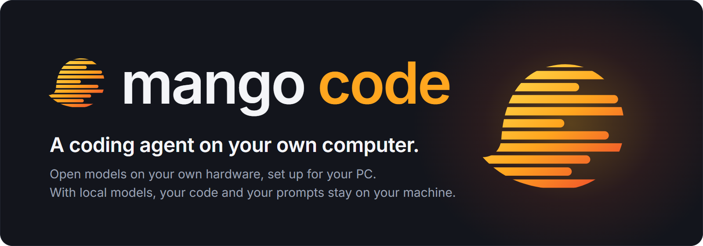

<p align="center">
  
</p>

<p align="center">
  <a href="LICENSE"></a>
  <a href="https://github.com/Federico-Anastasi/mango-code/releases"></a>
  
  
  
</p>

<p align="center">
  <b>Local models that fit your PC, an agent you can see into, and a desktop app that sets it all up.</b>
</p>

<p align="center">
  <a href="#features">Features</a> ·
  <a href="#screenshots">Screenshots</a> ·
  <a href="#speed">Speed</a> ·
  <a href="#tune-it-for-your-pc">Tune it for your PC</a> ·
  <a href="#install">Install</a> ·
  <a href="#privacy">Privacy</a> ·
  <a href="#build-from-source">Build from source</a> ·
  <a href="#license">License</a>
</p>

Mango Code is a desktop app for Windows, with an HTTP interface and a one-shot command for other programs. The agent is a fork of
[opencode](https://github.com/anomalyco/opencode); the models run on [llama.cpp](https://github.com/ggml-org/llama.cpp)
and on two engines of our own derived from it. The app is in English and Italian.

<p align="center">
  
  <br>
  <sub>A new conversation: the local model, the Team switch and the project.</sub>
</p>

## Features

**Local models, set up for your PC**
- At first run the app looks at your graphics cards, processor and memory, tells you which models fit and, for those that
  would run on the processor, how slow in words ("a word or two a second"), then downloads the right engine (CUDA for NVIDIA, Vulkan for AMD and Intel, or the processor
  alone) and the models you choose, with resume and checksum. A model runs entirely on the graphics cards, with the
  largest context that fits, or entirely on the processor.
- **Recommended models**, each with arguments tuned for it: Qwen3.6-35B-A3B (the default), Qwen3.8-27B, Ternary
  Bonsai 2 27B, Qwen3.8-27B-TOQ-v1 (our 2-bit trellis quantization), LFM2.5-24B-A2B, Qwen3.5-4B and Qwen3.5-2B (for
  4 GB graphics cards). Most of them read images.
- **Other open models.** Search Hugging Face, paste a link or pick a GGUF file already on your PC: before adding it,
  the app tells you whether it fits in memory and whether its chat template handles tools and long conversations.
- **Conversations that resume instantly.** Before the engine stops or switches model, it saves the conversation's
  state to disk; when you come back, it rereads only the new tokens instead of the whole conversation.

**An agent you can see into**
- **You decide what goes in the prompt.** Every built-in tool, MCP server, skill, instruction file and plugin can be
  turned on or off, for all folders or for one, and the settings page shows how many tokens each one costs.
- **Projects are git repositories**: a folder you open becomes one if it isn't (with an empty first commit), so every
  change the agent makes can be seen and undone. Never in a folder too broad to be a project (your user folder,
  Desktop, Documents, Downloads, OneDrive, a drive root: the app says so and offers a subfolder), nor in a folder that
  holds other repositories.
- **Built-in tools**: a browser the agent drives in the app's preview panel (or in your own Chrome), web search, Word,
  Excel, PowerPoint and PDF documents (a click on the card of a PDF or a picture shows it in that panel, also on the
  phone), voice dictation, and a set of skills for disciplined work (tests first,
  systematic debugging, verification before claiming success).

**Wherever you work**
- **Projects like a desktop app.** Open a folder, create a new project anywhere, or right-click a folder in File
  Explorer and choose "Open with Mango Code". Or just start writing: with no project yet, "New conversation" opens one
  in a "Conversations" folder ("Conversazioni" in Italian) inside Documents\Mango Code, a project like the others.
- **Team mode.** A cloud manager (DeepSeek V4.1 Flash through [OpenRouter](https://openrouter.ai), with your key) plans
  and checks, a local model does the hands-on work, and the manager can open up to four more cloud agents.
- **From your phone.** The same interface on your phone, over your Wi-Fi or from outside with
  [Tailscale](https://tailscale.com). Off by default; when you turn it on, access needs a random key.
- **The engine of another PC.** A PC with graphics cards can share its models with your other PCs, at home or with
  Tailscale: off by default, with a random key in a code you copy ("Share the engine with my PCs", on the "Models and
  engine" page). On the other PC, even a laptop without a graphics card, you paste the code in "Use the engine of another PC
  of mine" (the first thing the first start offers): no model and no engine to download, and the way back to the engine of that
  PC is one button.
- **For other apps.** A documented HTTP contract and a TypeScript client let another app start conversations, follow
  their events, answer permissions and borrow the graphics cards from the model when they need them:
  [`docs/INTEGRATION.md`](docs/INTEGRATION.md).
- **Tuning for your hardware**, with the `optimize` skill: see [Tune it for your PC](#tune-it-for-your-pc).

## Screenshots

| | |
|---|---|
|  |  |
| The agent writes a page and checks it in the built-in browser. | What the model reads: the token cost of every tool, on or off per folder. |
|  |  |
| Qwen3.6-35B-A3B, on the PC's own graphics cards, finds a bug, fixes it and runs the tests. | Team mode: a cloud manager and up to four cloud agents, through OpenRouter. |

## Speed

Measured on an RTX 3060 Ti + GTX 1080 + GTX 1660 SUPER with the profiles in
[`launcher/profiles/3060ti-1080-1660s/`](launcher/profiles/3060ti-1080-1660s), using `mango-bench`: the model started as
the app starts it, real text cut to the exact number of tokens, temperature 0, no prompt cache. Tokens per second.

| Model | Context | Prefill 1k / 32k / 64k | Decode 1k / 32k / 64k |
|---|---|---|---|
| Qwen3.6-35B-A3B (MoE) | 128k | 518 / 637 / 474 | 61.6 / 49.5 / 39.5 |
| Qwen3.8-27B (dense) | 92k | 267 / 258 / 204 | 25.4 / 16.8 / 13.1 |
| Ternary Bonsai 2 27B | 256k | 250 / 320 / 254 | 25.3 / 16.6 / 12.9 |
| Qwen3.8-27B-TOQ-v1 | 120k | 567 / 649 / 533 | 27.5 / 26.5 / 23.2 |
| LFM2.5-24B-A2B (MoE) | 128k | 1063 / 1496 / 1142 | 93.0 / 76.3 / 64.1 |

On other hardware the app uses a general plan, which works everywhere but is not tuned; the profiles above are a
starting point for PCs with the same cards.

## Tune it for your PC

Out of the box, Mango Code runs each model with a general plan that works on any PC but is not tuned for yours. The
[`optimize`](optimize/SKILL.md) skill closes that gap. Give it to a frontier coding agent (for example Claude Code) and
ask: "Optimize Mango Code on my PC". The agent asks which models you use and for permission to use your graphics cards,
then measures each model as the app starts it, changes one setting at a time, keeps only what is faster within the
measured noise and writes a profile for your hardware, which the app uses from then on.

The skill brings the knowledge base behind our own profiles: what we measured on NVIDIA cards from three generations,
the settings that paid off, the ones that did not and why. The installed app includes the skill and its measuring tool
(`mango-tune`): the models page has a link to the skill's folder.

## Install

1. Download `Mango.Code_<version>_x64-setup.exe` from the
   [latest release](https://github.com/Federico-Anastasi/mango-code/releases) (Windows 10 or 11, 64-bit).
2. Windows may show "Windows protected your PC": the installer has no paid code-signing certificate. Click "More info",
   then "Run anyway".
3. Open Mango Code. The installer is small: the engine and the models are downloaded at first run, only the ones that
   suit your PC.

Once per start the app looks for a newer release and offers to install it; updates carry their own signature, which
the app checks before installing.

## Privacy

The models run on your computer: your files, your prompts and the model's answers do not leave it. What goes online:

- **Downloads**: the engines from GitHub and the models from Hugging Face, the ones you choose.
- **Updates**: once per start, the app reads the latest release's `latest.json` from this repository.
- **Web search**, when the agent uses it: the query goes to DuckDuckGo, Bing and Startpage.
- **Team mode**, only when you turn it on: the conversation goes to OpenRouter, with your key.
- **"Report a problem"**, only when you click Send: the logs, the PC details and, if you leave the switch on, a
  screenshot of the window. Your user name, PC name, emails, network addresses and keys are removed before sending.

Access from your phone and sharing the engine with your other PCs are off by default. What the app protects, and what it does not: [SECURITY.md](SECURITY.md).

## Build from source

Requirements: Windows, git, Bun 1.4.4 or later, Rust and Node.js.

```powershell
npm ci --prefix launcher; npm ci --prefix launcher/opencode-home   # the node packages of the resources
app\scripts\build-agent.ps1       # the agent
app\scripts\build.ps1             # the desktop app's installer
```

The engines and the models are not part of the build (the models alone are ~60 GB): the app's first run downloads what a
model needs. Building our two engine forks from source is only for whoever works on them
(`app\scripts\build-engines.ps1 prism|toq`, which also needs CMake, Ninja, Visual Studio with the C++ tools, the CUDA 12
toolkit and clang-cl). Details: [`app/README.md`](app/README.md) for the app, [`launcher/MANGO-CODE.md`](launcher/MANGO-CODE.md)
for what it installs as resources.
How to contribute and run the tests: [CONTRIBUTING.md](CONTRIBUTING.md).

## Repository

```
mango-code/
├── app/          the desktop app (Rust, Tauri): engine manager, first run, settings, voice, phone access
├── launcher/     what the app installs as resources: model catalog, profiles, agent plugins
│                 and instructions, MCP servers, skills
├── packages/     the agent: opencode with Mango Code's changes
├── integration/  the client for other apps (TypeScript), examples and end-to-end tests
├── optimize/     the tuning skill and its knowledge base
└── docs/         the integration contract
```

The root also holds the rest of opencode's tree (`script/`, `infra/`, `nix/`, ...) as it is upstream.

## License

AGPL-3.0-or-later, with a few parts under other licenses: see [NOTICE.md](NOTICE.md). The name and logo follow
[TRADEMARKS.md](TRADEMARKS.md).
