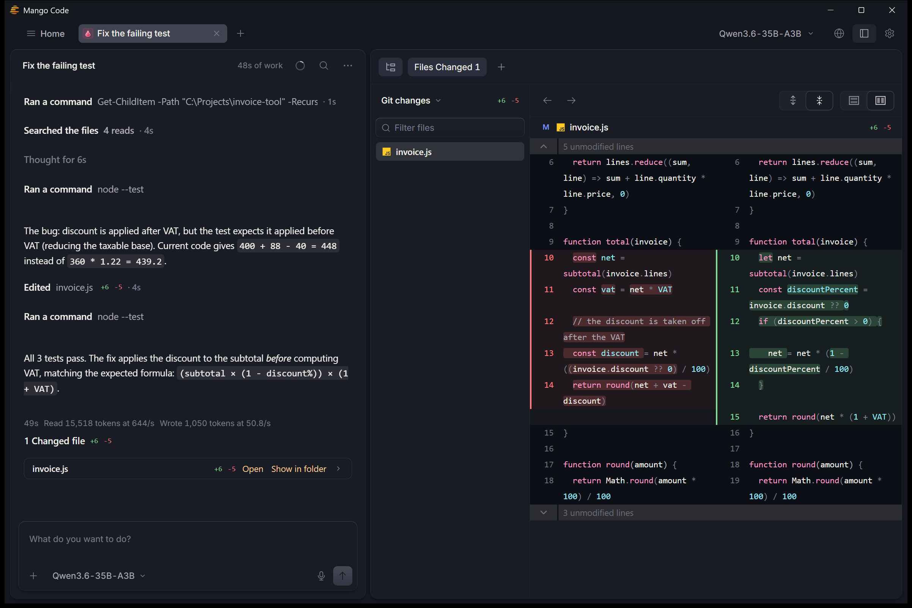
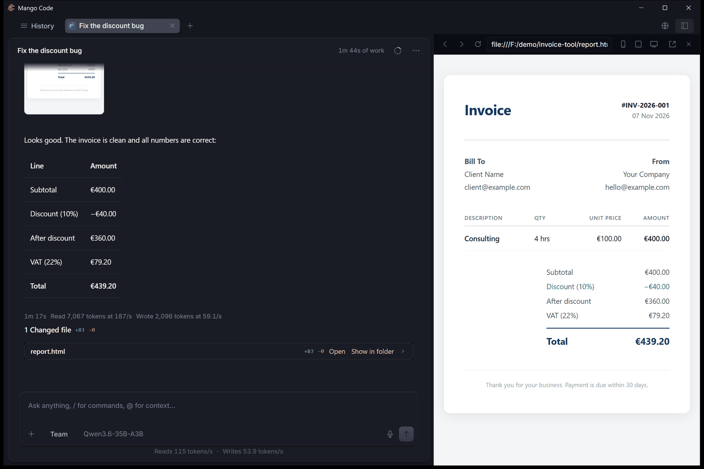
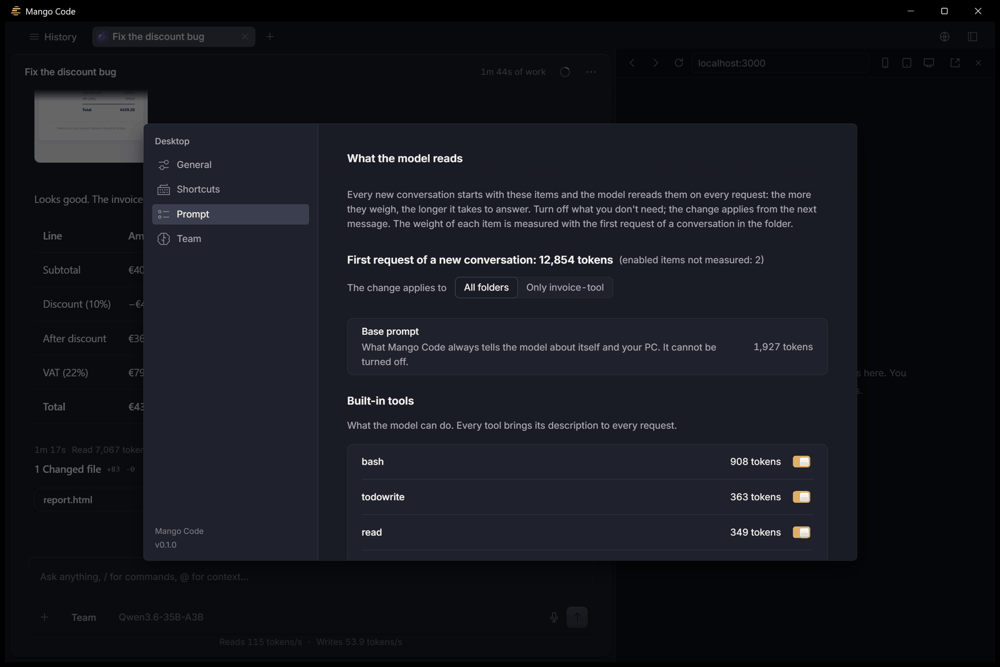
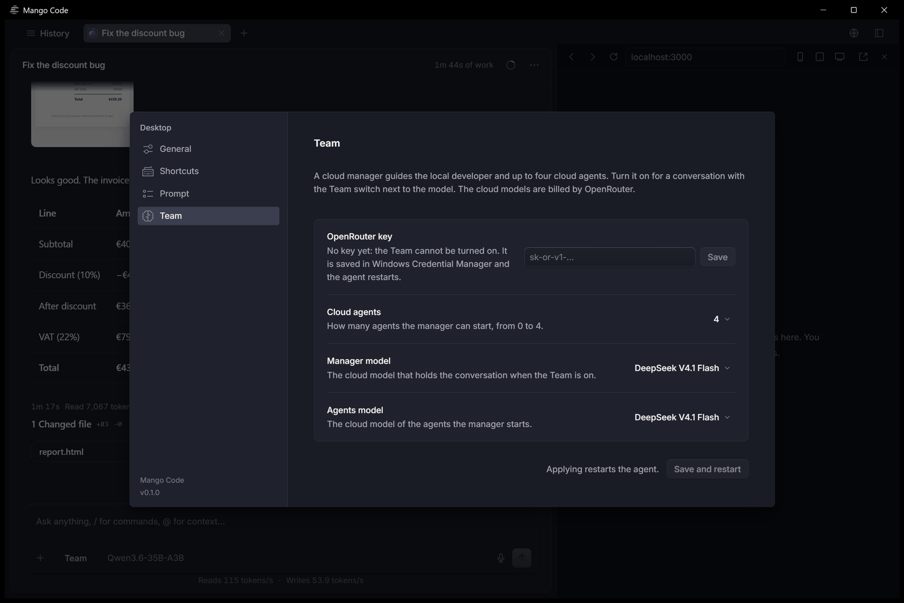
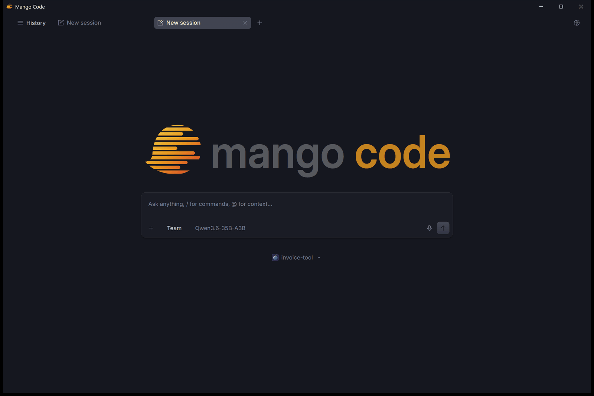

# Mango Code

A coding agent that runs on your own computer, with open models on your own hardware. Your code, your prompts and the
model's answers stay on your machine.

Mango Code is a desktop app for Windows, a terminal command and an HTTP interface for other apps. The agent is a fork of
[opencode](https://github.com/anomalyco/opencode); the models run on [llama.cpp](https://github.com/ggml-org/llama.cpp)
and on two engines of our own derived from it. The app is in English and Italian.



## Features

- **Local models, set up for your PC.** At first run the app looks at your graphics cards, processor and memory, tells
  you which models fit and how fast they are likely to be, then downloads the right engine (CUDA for NVIDIA, Vulkan for
  AMD and Intel, or the processor alone) and the models you choose, with resume and checksum. A model runs entirely on
  the graphics cards, with the largest context that fits, or entirely on the processor.
- **Recommended models**, each with arguments tuned for it: Qwen3.6-35B-A3B (the default), Qwen3.8-27B, Ternary
  Bonsai 2 27B, Qwen3.8-27B-TOQ-v1 (our 2-bit trellis quantization), LFM2.5-24B-A2B, Qwen3.5-4B and Qwen3.5-2B (for
  4 GB graphics cards). Most of them read images.
- **Other open models.** Search Hugging Face, paste a link or pick a GGUF file already on your PC: before adding it, the
  app tells you whether it fits in memory and whether its chat template handles tools and long conversations.
- **Conversations that resume instantly.** Before the engine stops or switches model, it saves the conversation's
  state to disk; when you come back, it rereads only the new tokens instead of the whole conversation.
- **You decide what goes in the prompt.** Every built-in tool, MCP server, skill, instruction file and plugin can be
  turned on or off, for all folders or for one, and the settings page shows how many tokens each one costs.
- **Built-in tools**: a browser the agent drives in the app's preview panel (or in your own Chrome), web search, Word,
  Excel, PowerPoint and PDF documents, voice dictation, and a set of skills for disciplined work (tests first,
  systematic debugging, verification before claiming success).
- **Projects like a desktop app.** Open a folder, create a new project anywhere, or right-click a folder in File
  Explorer and choose "Open with Mango Code".
- **Team mode.** A cloud manager (DeepSeek V4.1 Flash through [OpenRouter](https://openrouter.ai), with your key) plans
  and checks, a local model does the hands-on work, and the manager can open up to four more cloud agents.
- **From your phone.** The same interface on your phone, over your Wi-Fi or from outside with
  [Tailscale](https://tailscale.com). Off by default; when you turn it on, access needs a random key.
- **For other apps.** A documented HTTP contract and a TypeScript client let another app start conversations, follow
  their events, answer permissions and borrow the graphics cards from the model when they need them:
  [`docs/INTEGRATION.md`](docs/INTEGRATION.md).
- **Tuning for your hardware**, with the `optimize` skill: see [Tune it for your PC](#tune-it-for-your-pc).

## Screenshots

| | |
|---|---|
|  |  |
| The agent writes a page and checks it in the built-in browser. | What the model reads: the token cost of every tool, on or off per folder. |
|  |  |
| Team mode: a cloud manager and up to four cloud agents, through OpenRouter. | A new conversation, with the local model and the Team switch. |

## Speed

Measured on an RTX 3060 Ti + GTX 1080 + GTX 1660 SUPER with the profiles in
[`launcher/profiles/3060ti-1080-1660s/`](launcher/profiles/3060ti-1080-1660s), using `mango-bench`: the model started as the app starts it,
real text cut to the exact number of tokens, temperature 0, no prompt cache. Tokens per second.

| Model | Context | Prefill 1k / 32k / 64k | Decode 1k / 32k / 64k |
|---|---|---|---|
| Qwen3.6-35B-A3B (MoE) | 128k | 518 / 637 / 474 | 61.6 / 49.5 / 39.5 |
| Qwen3.8-27B (dense) | 92k | 267 / 258 / 204 | 25.4 / 16.8 / 13.1 |
| Ternary Bonsai 2 27B | 256k | 250 / 320 / 254 | 25.3 / 16.6 / 12.9 |
| Qwen3.8-27B-TOQ-v1 | 120k | 567 / 649 / 533 | 27.5 / 26.5 / 23.2 |
| LFM2.5-24B-A2B (MoE) | 128k | 1063 / 1496 / 1142 | 93.0 / 76.3 / 64.1 |

On other hardware the app uses a general plan, which works everywhere but is not tuned; the profiles above are a
starting point for PCs with the same cards.

## Tune it for your PC

Out of the box, Mango Code runs each model with a general plan that works on any PC but is not tuned for yours. The
[`optimize`](optimize/README.md) skill closes that gap. Give it to a frontier coding agent (for example Claude Code) and
ask: "Optimize Mango Code on my PC". The agent asks which models you use and for permission to use your graphics cards,
then measures each model as the app starts it, changes one setting at a time, keeps only what is faster within the
measured noise and writes a profile for your hardware, which the app uses from then on.

The skill brings the knowledge base behind our own profiles: what we measured on NVIDIA cards from three generations,
the settings that paid off, the ones that did not and why. The installed app includes the skill and its measuring tool
(`mango-tune`): the models page has a link to the skill's folder.

## Install

Download the installer from this repository's Releases page and run it (Windows 10 or 11, 64-bit). The installer is
small: the engine and the models are downloaded at first run, only the ones that suit your PC. Version 0.1.0 is not
signed, so Windows may ask you to confirm.

## Build from source

Requirements: Windows, git, Bun 1.4.2 or later, Rust, Node.js; to build the engines also CMake, Ninja, Visual Studio
with the C++ tools, the CUDA 12 toolkit and clang-cl.

```powershell
cd launcher; .\setup.ps1          # engines, agent, models, dependencies and the mango-code command
..\app\scripts\build.ps1          # the desktop app's installer
```

`setup.ps1` also works in parts (`-Only llama-prism|llama-toq|opencode|models|npm|config|command`). Details:
[`launcher/MANGO-CODE.md`](launcher/MANGO-CODE.md) for the terminal, [`app/README.md`](app/README.md) for the app.

Tests: `cargo test --workspace` in `app/`, and `bun test --cwd integration` from the root (end-to-end, with a fake
engine: no graphics card is used).

## Repository

```
mango-code/
├── app/          the desktop app (Rust, Tauri): engine manager, first run, settings, voice, phone access
├── launcher/     the terminal, and what the app installs as resources: model catalog, profiles, agent plugins
│                 and instructions, MCP servers, skills
├── packages/     the agent: opencode with Mango Code's changes
├── integration/  the client for other apps (TypeScript), examples and end-to-end tests
├── optimize/     the tuning skill and its knowledge base
└── docs/         the integration contract
```

The root also holds the rest of opencode's tree (`script/`, `infra/`, `nix/`, ...) as it is upstream.

## License

AGPL-3.0-or-later, with a few parts under other licenses: see [NOTICE.md](NOTICE.md). The name and logo follow
[TRADEMARKS.md](TRADEMARKS.md).
